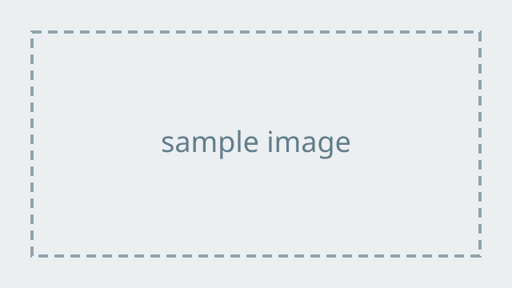

## 今日の流れ

1. 基本の書き方
2. Typst の機能を使う
3. 発表の準備

# 基本の書き方

## 見出しとスライド

- `# 見出し` はセクション区切りのスライドになる
- `## 見出し` ごとに 1 枚のスライドになる
- **太字**や `コード` は Markdown のまま書ける
    - 箇条書きはネストできる

## 表

| 項目 | 説明 |
|------|------|
| Quarto | Markdown から Typst を生成する |
| Typst | PDF を組版する |
| Touying | スライドのテーマとアニメーション |
| pdfpc | 発表者画面を表示する |

## 2段組

:::: {.columns}

::: {.column width="50%"}
左の段

- 箇条書き
- 箇条書き
:::

::: {.column width="50%"}

:::

::::

## 画像と数式

{width=50%}

インライン数式 $E = mc^2$ と別行立て数式:

$$
\int_0^1 x^2 \, dx = \frac{1}{3}
$$

# Typst の機能を使う

## 段階表示

最初に表示される

`#pause`{=typst}

次のクリックで表示される

`#pause`{=typst}

さらに次のクリックで表示される

## 出典表記

引用した図や例には出典を添える

`#src[〇〇「資料のタイトル」2026年]`{=typst}

## Typst を直接書く

```{=typst}
#align(center)[
  #rect(fill: luma(240), inset: 16pt, radius: 4pt)[
    Typst のコードをそのまま埋め込める
  ]
]
```

# 発表の準備

## スピーカーノート

`::: {.notes}` の中身は、スライドには表示されず pdfpc の発表者画面にだけ出る

::: {.notes}
これはスピーカーノートの例。話す内容のメモを書いておく。
:::

## まとめ

- `make` で PDF と pdfpc 用ファイルを生成
- `make present` で発表開始
